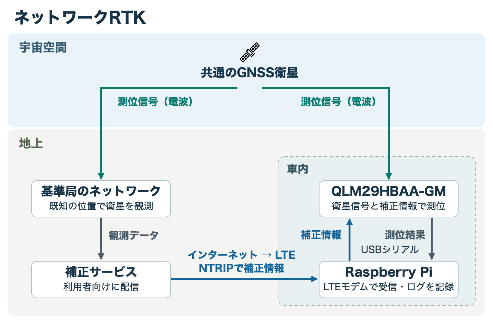
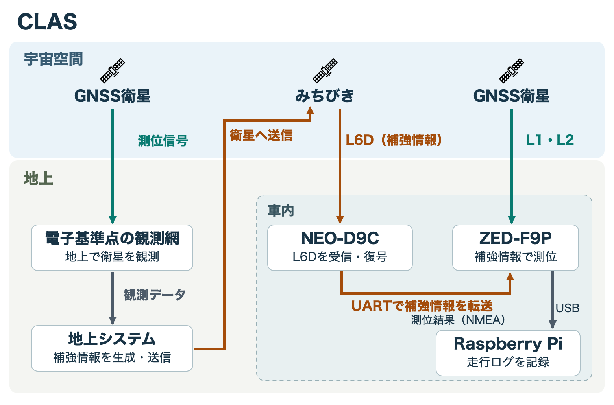

:::message
「[一般消費者が事業者の表示であることを判別することが困難である表示](https://www.caa.go.jp/policies/policy/representation/fair_labeling/guideline/assets/representation_cms216_230328_03.pdf)」の運用基準に基づく開示: この記事は記載の日付時点で[株式会社ソラコム](https://soracom.jp/)に所属する社員が執筆しました。ただし、個人としての投稿であり、株式会社ソラコムとしての正式な発言や見解ではありません。
:::

## はじめに

車に2台の[GNSS](#gnss)トラッカーを載せて走った話を、2本の記事にまとめました。前編では、[RTK](#rtk)と[CLAS](#clas)の受信機をRaspberry Piに接続し、位置を記録して送るまでを紹介しています。

https://zenn.dev/takao2704/articles/gnss-rtk-clas-tracker

後編では、その走行ログをQGISでソラカメの画像と見比べながら、駐車時の切り返しで車体の向きがどう変わったかを追ってみました。

https://zenn.dev/takao2704/articles/gnss-rtk-clas-qgis-soracam

この2本を書いていたら、「[NTRIP](#ntrip)で[RTCM](#rtcm)を受け取る」とか「[FIX](#fix)から[FLOAT](#float)に変わった」とか、謎のアルファベットの略語が大量に出てきて、自分でもわけが分からなくなってきました。そこで、それぞれが何を指していて、今回のトラッカーのどこで使ったのか、ここにまとめます。

## 用語一覧

| 分類 | 用語（クリックすると説明へ移動します） |
| --- | --- |
| 測位方式と測位状態 | [CLAS](#clas) / [DGPS](#dgps) / [DOP](#dop) / [DR](#dr) / [FIX](#fix) / [FLOAT](#float) / [GNSS](#gnss) / [GPS](#gps) / [HDOP](#hdop) / [PPP-RTK](#ppp-rtk) / [QZSS](#qzss) / [RTK](#rtk) / [SPS](#sps) |
| 補正データの配信と形式 | [CNR](#cnr) / [Compact SSR](#compact-ssr) / [ECEF](#ecef) / [FKP](#fkp) / [MSM](#msm) / [NTRIP](#ntrip) / [RTCM](#rtcm) / [ST](#st) / [STEC](#stec) / [URA](#ura) / [VRS](#vrs) |
| 受信機の接続と出力 | [GGA](#gga) / [GSA](#gsa) / [GSV](#gsv) / [INCOMPLETE](#incomplete) / [L1](#l1) / [L2](#l2) / [L5](#l5) / [L6D](#l6d) / [NMEA](#nmea) / [NO_FIX](#no_fix) / [PRN](#prn) / [RF](#rf) / [RMC](#rmc) / [UART](#uart) / [UBX](#ubx) / [USB](#usb) |
| 車載した受信機・基板 | [D9CX1](#d9cx1) / [F9PX1](#f9px1) / [NEO-D9C](#neo-d9c) / [QLM29HBAA-GM](#qlm29hbaa-gm) / [ZED-F9P](#zed-f9p) |

## 用語の説明

### 測位方式と測位状態

#### GNSS

Global Navigation Satellite System（衛星測位システム）。[GPS](#gps)や日本の[みちびき](#qzss)など、衛星の信号で位置を求めるシステムの総称です。

#### GPS

Global Positioning System。米国の衛星測位システムです。今回の受信機はGPSを含む複数の衛星システムの信号を使えます。

#### QZSS

Quasi-Zenith Satellite System（準天頂衛星システム）。日本の「みちびき」です。測位信号に加え、今回の[CLAS](#clas)側で使う補強信号も送っています。

#### RTK

Real-Time Kinematic（リアルタイムキネマティック測位）。位置が分かっている基準局と移動側の受信機で同じ衛星を観測し、両者に共通する誤差を減らします。搬送波の位相を使うので、波長より細かな距離の変化も追えます。

**ネットワークRTK**では、配信サービスが複数の基準局の観測をもとに、利用者の周辺に適した補正情報を作ります。利用者の近くに基準局があるかのような観測データを作る[VRS](#vrs)や、補正量の地域差を伝える[FKP](#fkp)などの方式があります。今回のトラッカーは、[RTCM](#rtcm)形式のデータを[NTRIP](#ntrip)で受け取ります。[RTKの原理解説（NovAtel）](https://novatel.com/an-introduction-to-gnss/resolving-errors/real-time-kinematics-rtk)

*緑は基準局と車に届く測位信号です。青をたどると、地上の補正サービスからLTE経由でRaspberry Piへ、さらにUSB経由で受信機へと補正情報が届きます。*

#### CLAS

Centimeter Level Augmentation Service（センチメータ級測位補強サービス）。電子基準点の観測をもとに、地上で衛星の軌道や時計のずれ、信号ごとの偏り、電離層や対流圏の遅れを見積もります。これらを[Compact SSR](#compact-ssr)形式でまとめ、[みちびき](#qzss)の[L6D](#l6d)信号に載せて配信します。

車載側は空から測位信号と補強信号の両方を受けます。今回の構成では、[NEO-D9C](#neo-d9c)が復号した補強情報を[ZED-F9P](#zed-f9p)が自身の衛星観測に適用し、[PPP-RTK](#ppp-rtk)で位置を求めます。[CLASのサービス仕様（内閣府）](https://qzss.go.jp/technical/system/l6.html)

*橙は補強情報の経路です。地上で作った情報がみちびきを経由して車に届き、ZED-F9Pが緑の測位信号と組み合わせて位置を求めます。*

#### PPP-RTK

Precise Point Positioning – Real-Time Kinematic。衛星の軌道・時計や地域ごとの大気の補正情報を、手元の受信機の観測に適用する測位方式です。[CLAS](#clas)はこの方式に必要な情報を配信します。

#### FIX

搬送波の波が衛星とアンテナの間に何個分あるか、その数を整数として確定して求めた測位解です。走行ログでは、受信機がこの状態を出力した点をFIXとして数えています。

#### FLOAT

搬送波の波数を実数のまま推定して求めた測位解です。FLOATの間も位置が出るので、地図上で[FIX](#fix)の点と色分けして比べられます。

#### SPS

Standard Positioning Service。今回のログでは、受信機が衛星からの測位信号で位置を求めた単独測位の状態を示します。

#### DGPS

Differential [GPS](#gps)（差分GPS）。位置が分かっている基準局で、衛星までの距離を計算し、信号から測った距離（擬似距離）と比べます。近くの車で同じ衛星を見ていれば、衛星の時計のずれや大気による遅れはよく似ています。そこで、基準局で見積もった誤差を車でも補正に使えます。[DGPSの仕組み（ESA）](https://gssc.esa.int/navipedia/index.php?title=DGNSS_Fundamentals)

配るのは、**どの時刻の、どの衛星の距離を、どれだけ直すか**というデータです。たとえば、ある時刻にGPS衛星G12までの距離が5 m長く測れていたら、G12の補正値は「−5 m」です。車の受信機は、自分が測ったG12までの距離から5 mを引きます。他の衛星にもそれぞれの補正値を適用してから、車の位置を計算します。

補正を届ける経路はサービスによって違います。

- **地上の無線**を使った例が、船舶向けのDGPSです。沿岸の無線局が複数の衛星の補正値をまとめて放送し、周辺の船が受信していました。[米国沿岸警備隊のDGPS資料](https://www.navcen.uscg.gov/sites/default/files/pdf/waterways/shallow_draft/CIM_16500_1D%20ATON%20Positioning%20and%20Range%20Surveying.pdf)
- **インターネット**では、[NTRIP](#ntrip)を使って補正値や基準局の観測データを配信できます。今回のネットワーク[RTK](#rtk)もこの経路で、Raspberry PiがLTE経由でデータを受け取り、[USB](#usb)で[車載受信機](#qlm29hbaa-gm)へ渡します。[NTRIPの解説（BKG）](https://igs.bkg.bund.de/ntrip/about)
- **衛星経由**の例が、[みちびき](#qzss)のサブメータ級測位補強サービス（SLAS）です。地上で作った補正情報をL1S信号に載せ、対応する受信機に届けます。今回使った[CLAS](#clas)は、同じみちびきの[L6D](#l6d)信号で、衛星の軌道や時計、大気の遅れなどの補強情報を届けます。[SLASの仕様（内閣府）](https://qzss.go.jp/technical/system/l1s.html)

#### DR

Dead Reckoning（推測航法）。直前の位置と、その後の移動量や向きから現在位置を推定した状態です。

#### DOP

Dilution of Precision（精度低下率）。衛星の配置が、位置や時刻の推定誤差をどれだけ増幅しやすいかを表す指標です。水平方向については[HDOP](#hdop)を見ます。

#### HDOP

Horizontal Dilution of Precision（水平精度低下率）。衛星の配置によって、水平方向の測位誤差がどれだけ増幅されやすいかを示す指標です。

### 補正データの配信と形式

#### NTRIP

Networked Transport of [RTCM](#rtcm) via Internet Protocol。今回、[RTK](#rtk)側のRaspberry Piがインターネット経由で補正データを受け取るために使う通信方式です。

#### RTCM

Radio Technical Commission for Maritime Services（規格を策定した団体）。本文では、その団体が定めた[GNSS](#gnss)観測・補正データの形式を指します。

:::details 補足：RTCMの代表的なメッセージ

代表的なRTCMメッセージを並べると、次のようになります。

| メッセージ | 主な内容 |
| --- | --- |
| 1005 / 1006 | 基準局のアンテナ基準点の座標。1006にはアンテナ高も含む |
| [MSM4](#msm)：GPS 1074 / [QZSS](#qzss) 1114など | コード擬似距離、搬送波位相、CNR |
| [MSM7](#msm)：GPS 1077 / QZSS 1117など | より高分解能の観測と距離変化率の情報 |
| 1033など | アンテナや受信機の識別・記述情報 |

基準点の座標は、地球中心を原点とする[ECEF](#ecef)という直交座標で表されます。[CNR](#cnr)（Carrier-to-Noise Ratio）は搬送波と雑音の比で、信号品質を見る指標です。表の番号はRTCMのメッセージ番号で、受信機メーカー独自のログ番号とは区別します。

[RTCMv3とMSMの説明（NovAtel）](https://docs.novatel.com/OEM7/Content/Logs/RTCMV3_Standard_Logs.htm)

:::

#### MSM

Multiple Signal Message。複数の衛星・信号の観測値をまとめる[RTCM](#rtcm)のメッセージです。MSM4とMSM7では、観測値の分解能や収録項目が異なります。

#### VRS

Virtual Reference Station（仮想基準局）。ネットワーク[RTK](#rtk)の方式の一つで、利用者の近くに基準局を置いた場合に相当する観測データを配信します。

#### FKP

Flächenkorrekturparameter（面補正パラメータ）。ネットワーク[RTK](#rtk)の方式の一つで、地域内で補正量がどう変わるかを表すパラメータを配ります。

#### ECEF

Earth-Centered, Earth-Fixed（地球中心・地球固定座標系）。地球の中心を原点に、地球とともに回る3本の軸で位置を表します。[RTCM](#rtcm)に入っている基準局の座標を読むときに出てきます。

#### CNR

Carrier-to-Noise Ratio（搬送波対雑音比）。受信した搬送波が雑音に対してどれくらい強いかを表します。

#### Compact SSR

Compact State Space Representation。衛星の軌道・時計や大気の影響などを項目ごとに分けて、小さなデータ量で表す形式です。[CLAS](#clas)の補強データに使われます。

:::details 補足：CLASの補強データの内訳

CLASで使うCompact SSRは、衛星や大気などの状態に対応する補正情報を圧縮して表します。代表例を、発表で参照したIS-QZSS-L6-007の分類でまとめると次のとおりです。

| サブタイプ | 主な内容 |
| --- | --- |
| [ST1](#st) | 補強対象の衛星・信号を示すマスク |
| ST2 / ST3 / ST11 | 衛星軌道、時計、両者を組み合わせた補正 |
| ST4 / ST5 / ST6 | コード・位相のバイアス、両者を組み合わせた補正 |
| ST12 | 電離層の[STEC](#stec)や対流圏の補正。地域の係数やグリッド残差など |
| ST7、ST12内の品質情報 | [URA](#ura)や大気補正の品質情報 |

メッセージは4073とサブタイプの組み合わせで識別します。STECは衛星への視線方向の総電子数、バイアスは信号ごとの系統的な偏りです。品質情報は補正に残る不確かさの目安で、個々の測位点の実際の位置誤差を測った値ではありません。ST8やST9なども定義されており、全サブタイプが常時送られるわけではありません。

ここでの分類は[IS-QZSS-L6-007（2025年7月31日版）](https://qzss.go.jp/en/technical/download/pdf/ps-is-qzss/is-qzss-l6-007.pdf)に基づきます。実装時には[公式の仕様書一覧](https://qzss.go.jp/technical/download/ps-is-qzss.html)から参照する版を確認してください。

:::

#### ST

Subtype（サブタイプ）。[CLAS](#clas)の補強データの種類を表します。たとえばST1は、どの衛星と信号が補強の対象かを示します。

#### STEC

Slant Total Electron Content（斜め方向の総電子数）。受信機から衛星までの経路に沿った電子の量で、電離圏を通る電波の遅延を補正するために使います。

#### URA

User Range Accuracy。[CLAS](#clas)の補強情報では、衛星ごとに補正したあとの距離にどの程度の不確かさが残るかを見る指標です。

配信方式や補強データの項目をさらに詳しく見るには、[BKGのNTRIP解説](https://igs.bkg.bund.de/ntrip/about)と[みちびきのCLAS仕様書](https://qzss.go.jp/en/technical/download/pdf/ps-is-qzss/is-qzss-l6-007.pdf)を参照してください。

### 受信機の接続と出力

#### L1

[GPS](#gps)や[みちびき](#qzss)のL1帯の中心周波数は **1575.42 MHz** です。代表的な測位信号の一つがL1C/Aです。受信機は、衛星ごとに決まった符号（[PRN](#prn)コード）がどれだけ遅れて届いたかを測り、衛星までの距離を見積もります。同じ信号には、衛星の位置を計算するための軌道情報や、衛星の時計のずれを補う値も載っています。これが航法メッセージです。今回の2台はどちらもL1帯に対応しています。

#### L2

中心周波数は **1227.60 MHz** です。[GPS](#gps)や[みちびき](#qzss)の民生用信号L2Cには、距離を測るための符号と、衛星の軌道や時計の情報を伝える航法メッセージが含まれます。電波が電離層を通るときの遅れは周波数によって変わるので、同じ衛星を[L1](#l1)とL2で測ると、その遅れを見積もれます。今回の[CLAS](#clas)側の測位受信機はこの2つの帯域に対応しています。

#### L5

中心周波数は **1176.45 MHz** です。[GPS](#gps)や[みちびき](#qzss)のL5信号には、衛星の軌道や時計の情報を伝える成分と、受信機が信号を追い続けるためのパイロット成分があります。どちらにも距離を測るための符号が入っています。今回のネットワーク[RTK](#rtk)側の受信機が対応するのは、[L1](#l1)とL5の組み合わせです。

#### L6D

中心周波数は **1278.75 MHz** です。[みちびき](#qzss)が[CLAS](#clas)の補強情報を届けるのに使う信号です。[Compact SSR](#compact-ssr)という形式で、衛星の軌道や時計を補正する値、電離層や対流圏で生じる電波の遅れなどを伝えます。今回のトラッカーでは[NEO-D9C](#neo-d9c)がL6Dを受信し、[ZED-F9P](#zed-f9p)がその補強情報を[L1](#l1)・[L2](#l2)の測位に使います。

信号ごとの周波数とデータの内訳は、内閣府の[送信信号一覧](https://qzss.go.jp/overview/services/sv03_signals.html)、[衛星測位サービスの仕様](https://qzss.go.jp/technical/system/pnt.html)、[CLASの仕様](https://qzss.go.jp/technical/system/l6.html)で確認できます。

#### RF

Radio Frequency（高周波）。配線の説明にある「RF分岐」は、アンテナが受けた高周波信号を2枚の受信基板に分ける部分です。

#### UART

Universal Asynchronous Receiver/Transmitter。機器同士でデータを順番に送受信するシリアル通信に使います。ここでは[D9C](#neo-d9c)から[F9P](#zed-f9p)へ補強データを渡す接続です。

#### USB

Universal Serial Bus。今回のトラッカーでは、測位受信機とRaspberry Piをつなぎ、受信機が出力した位置や時刻を読み取ります。

#### UBX

u-blox独自のバイナリ通信形式です。`UBX-RXM-QZSSL6`は、今回の構成では[D9C](#neo-d9c)が[みちびき](#qzss)の[L6D](#l6d)で受けた補強データを[F9P](#zed-f9p)へ渡すときのメッセージ名です。

#### NMEA

National Marine Electronics Association（規格を策定した団体）。本文では、受信機が位置や時刻を1行ずつ出力するNMEA 0183形式を指します。

#### RMC

Recommended Minimum Specific [GNSS](#gnss) Data。日付・時刻・位置・速度などを含む[NMEA](#nmea)の文です。送信プログラムでは、この文から測位した日の日付を読み取ります。

#### GGA

Global Positioning System Fix Data。測位時刻、緯度・経度、測位状態、使用衛星数などを含む[NMEA](#nmea)の文です。同じ測位時刻の[RMC](#rmc)と組み合わせて日付付きの位置ログにします。

#### PRN

Pseudo-Random Noise。もともとは衛星信号を識別するための疑似ランダム雑音符号のことです。衛星をログや配置図で突き合わせるときは、[GPS](#gps)などのシステム名と衛星番号を組にして扱います。

#### GSV

Satellites in View。衛星ごとの番号・仰角・方位・信号強度などを伝える[NMEA](#nmea)の文です。衛星がどの方向にいて、どのくらいの強さで信号が届いたかを調べるときに使います。

#### GSA

[GNSS](#gnss) [DOP](#dop) and Active Satellites。測位に使った衛星の番号や、衛星配置による精度低下の指標を伝える[NMEA](#nmea)の文です。[GSV](#gsv)と照合すると、どの方向の衛星を測位に使ったかを追えます。

#### NO_FIX

受信機から有効な位置が得られなかったときに、今回の送信プログラムが記録する状態名です。緯度・経度は `null` で残します。

#### INCOMPLETE

同じ測位時刻の[RMC](#rmc)と[GGA](#gga)など、記録に必要な文がそろわなかったときに送信プログラムが付ける状態名です。

### 車載した受信機・基板

#### QLM29HBAA-GM

今回、ネットワーク[RTK](#rtk)側に使ったQuectel製の[GNSS](#gnss)受信機です。Raspberry Piから補正データを受け取り、測位結果を返します。

#### F9PX1

[CLAS](#clas)側で位置を計算するために使った、[ZED-F9P](#zed-f9p)搭載の受信基板です。

#### ZED-F9P

[F9PX1](#f9px1)に載っているu-blox製の測位モジュールです。今回の構成では、衛星の測位信号と[NEO-D9C](#neo-d9c)から届く補強情報を使って位置を計算します。

#### D9CX1

[CLAS](#clas)側で補強信号を受けるために使った、[NEO-D9C](#neo-d9c)搭載の基板です。

#### NEO-D9C

[D9CX1](#d9cx1)に載っているu-blox製の受信モジュールです。[みちびき](#qzss)から[L6D](#l6d)信号を受けて復号したデータを、測位用の[ZED-F9P](#zed-f9p)へ渡します。

## 関連記事

- [Raspberry Piで作るRTK・CLASトラッカーと、走行ログをHarvest Dataに送る仕組み](./gnss-rtk-clas-tracker)
- [実測！：2つの高精度測位（CLAS,RTK）を積んだ車の向きはどこまで読めるのか](./gnss-rtk-clas-qgis-soracam)
