:::message
「[一般消費者が事業者の表示であることを判別することが困難である表示](https://www.caa.go.jp/policies/policy/representation/fair_labeling/guideline/assets/representation_cms216_230328_03.pdf)」の運用基準に基づく開示: この記事は記載の日付時点で[株式会社ソラコム](https://soracom.jp/)に所属する社員が執筆しました。ただし、個人としての投稿であり、株式会社ソラコムとしての正式な発言や見解ではありません。
:::

## TL;DR

- 地図上の測位点をクリックすると、車載したATOM Cam 2の録画からその時刻の画像を開けるQGISプラグインを作りました。
- 2台とも速度が0.1km/h以下で、それぞれの測位点がほぼ同じ場所に集まった区間が45秒間ありました。ログを見ると、停車していそうな区間が分かります。
- 前後のアンテナが両方とも[FIX](./gnss-rtk-clas-glossary#fix)だった41組から、駐車時の切り返しで車体の向きが変わる様子を追えました。方位の精度を確かめるには、車体が実際に向いていた角度との比較が必要です。
- 当時の衛星配置を計算すると、13:15には東の空の仰角約6度に[GPS](./gnss-rtk-clas-glossary#gps)衛星がいました。高速道路では真上が開けていても、こうした低い位置の衛星は防音壁に隠れる可能性があります。

## はじめに

[2026年10月22日のMIERUNE JCT in Tokyo](https://mierune.connpass.com/event/405920/)で紹介した、自作[GNSS](./gnss-rtk-clas-glossary#gnss)トラッカーの車載実験の後編です。[前編](https://zenn.dev/takao2704/articles/gnss-rtk-clas-tracker)では、ネットワーク[RTK](./gnss-rtk-clas-glossary#rtk)と[CLAS](./gnss-rtk-clas-glossary#clas)の受信機とRaspberry Piの接続、ログの保存・再送を紹介しました。 測位状態や衛星ログの略語は、[高精度GNSSトラッキング関連用語集](./gnss-rtk-clas-glossary)で引けます。

今回は、走行中に測位状態が変わった場所で「このとき、どんなところを走っていたんだろう？」と振り返れるように、QGISで位置と車載画像を一緒に見られるプラグインを作りました。

https://github.com/takao2704/qgis-soracom-tracks

## 全体構成

構成は、位置情報と映像の2つの流れに分かれます。

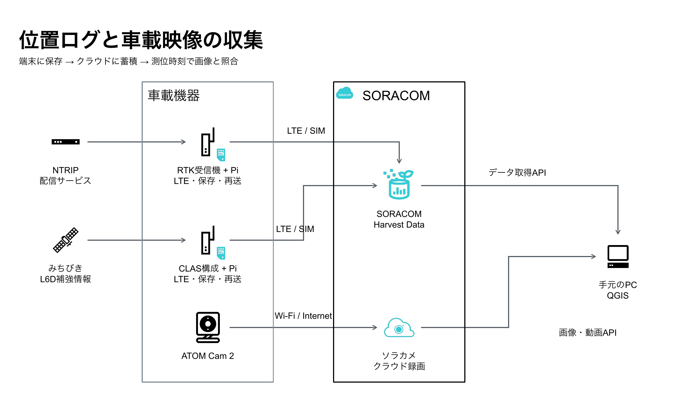
*各トラッカーは受信機とRaspberry Piをまとめて表しています。RTK側ではRaspberry Piがインターネット経由で[NTRIP](./gnss-rtk-clas-glossary#ntrip)配信サービスから補正データを受け取り、受信機へ渡します。矢印はデータが流れる向きです。*

前編で作った2台のトラッカーから、5秒間隔の位置ログをHarvest Dataに送りました。これにソラカメのクラウド録画を組み合わせ、QGISから位置と画像を取得します。受信機の配線やアンテナの設置写真は前編にまとめています。

:::message
位置はログの測位時刻`measured_at`で並べ、Harvest Dataに到着した`received_at`とは分けて扱います。各点の測位状態は、受信機が出力した[NMEA](./gnss-rtk-clas-glossary#nmea)の[GGA](./gnss-rtk-clas-glossary#gga)から読み取れます。[FIX](./gnss-rtk-clas-glossary#fix)も[FLOAT](./gnss-rtk-clas-glossary#float)も補正を使った搬送波測位の結果で、搬送波の波数を整数として確定できた点がFIX、まだ確定していない点がFLOATです。衛星ごとにどの補強情報を使ったかを調べるには、受信機の詳しいログが必要です。
:::

ソラカメとの連携は任意なので、位置情報だけでも試せます。背景地図にはOpenStreetMapを使いました。

## 起動から走行までの記録

### 起動からFIXまでの時間

送信プログラムはRaspberry Piの起動に合わせて動きます。表の開始時刻から最初のFIXが記録されるまで、**RTK側はおおむね1分、CLAS側はおおむね15分**でした。

| 機器 | 記録で確認した開始 | 最初に確認したFIX | 経過時間 |
| --- | --- | --- | --- |
| RTK | サービス開始 10:11:41 | 10:12:38 | 約57秒 |
| CLAS | 最初の測位ログ 10:49:14 | 11:04:20 | 15分6秒 |

RTK側は最初に保存された記録がすでにFIXで、CLAS側はFLOATからFIXへの変化を確認できました。

:::message
時刻はJSTです。RTK側はサービスの開始、CLAS側は最初の測位ログを起点にしています。この時間は、それぞれの機器をその日に起動したときの目安です。
:::

### 静止確認では両方ともFIX

FIXを確認した後、2026年10月22日11:26ごろに静止状態で記録を確認しました。

| 項目 | RTK | CLAS |
| --- | ---: | ---: |
| 最新の測位時刻 | 11:26:20 | 11:26:20 |
| 直近5分のFIX | 60件 / 60件 | 60件 / 60件 |
| 記録間隔 | 5秒 | 5秒 |
| この範囲の欠測・重複ID | なし | なし |
| 使用衛星数 | 37 | 12 |
| [HDOP](./gnss-rtk-clas-glossary#hdop) | 0.48 | 0.75 |
| 補正情報の経過時間 | 1秒 | 3秒 |
| 最新1件のHarvest到着遅延 | 約0.87秒 | 約0.75秒 |

使用衛星数とHDOPは、11:26:20（JST）に各受信機が出力した値です。到着遅延も、この1点が測位されてからHarvest Dataに届くまでの時間を示しています。

### 実走記録の集計

発表では、2026年10月22日の12:30〜13:48:38 JSTの記録を集計しました。12:30は、ログを切り出すために仮に置いた開始時刻です。

| 項目 | RTK | CLAS |
| --- | ---: | ---: |
| 受信記録 | 937件 | 930件 |
| 重複を除いた記録 | 937件 | 929件 |
| 地図に描画した有効点 | 937点 | 924点 |
| [FIX](./gnss-rtk-clas-glossary#fix) | 532件 | 41件 |
| [FLOAT](./gnss-rtk-clas-glossary#float) | 392件 | 735件 |
| [DGPS](./gnss-rtk-clas-glossary#dgps) | 9件 | 136件 |
| [SPS](./gnss-rtk-clas-glossary#sps) | 1件 | 12件 |
| [DR](./gnss-rtk-clas-glossary#dr) | 3件 | 0件 |
| [NO_FIX](./gnss-rtk-clas-glossary#no_fix) | 0件 | 5件 |

測位状態の意味は[前編](https://zenn.dev/takao2704/articles/gnss-rtk-clas-tracker)で説明しました。表のDGPSは差分補正による測位、SPSは単独測位、DRは推測航法です。NO_FIXは有効な測位解がない状態として記録しています。

地図に描けた点のうち、受信機がFIXを返したのは、RTK側が937点中532点（56.8%）、CLAS側が924点中41点（4.4%）でした。CLAS側の924点は、受信した930件から重複1件とNO_FIXの5件を除いた数です。

今回の記録では、RTK側はFIXとFLOAT、CLAS側はFLOATが多く見られました。2台は異なる測位モジュールを使っています。走行ログには、各時刻に何機の衛星を使ったかを残しました。次回は、それぞれの受信機が測位に使った衛星の番号（[PRN](./gnss-rtk-clas-glossary#prn)など）も時刻と一緒に残しておきたいです。そうすれば、FIXの割合に差が出た区間で、2台が空のどの方向の衛星を使っていたかを比べられます。

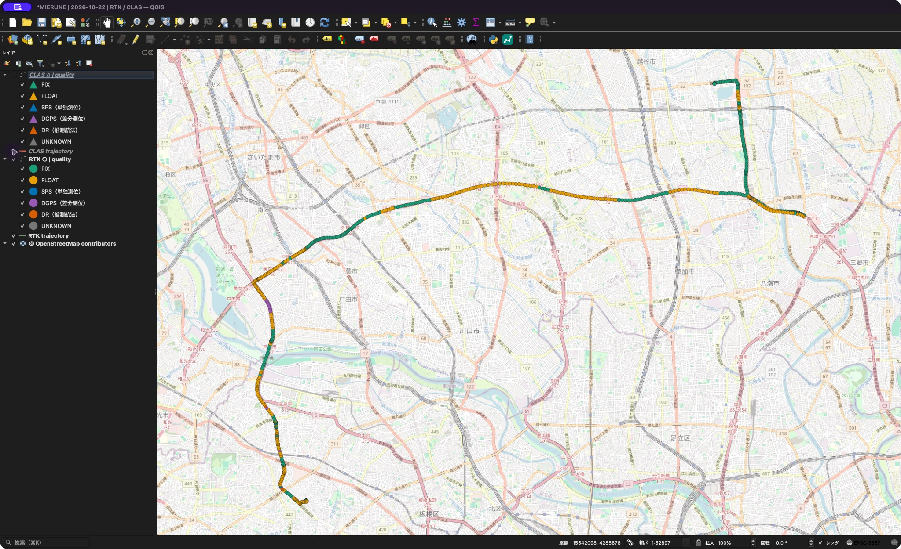
*RTK側の有効点937点。緑がFIX、黄がFLOATです。地図：[© OpenStreetMap contributors](https://www.openstreetmap.org/copyright)。*

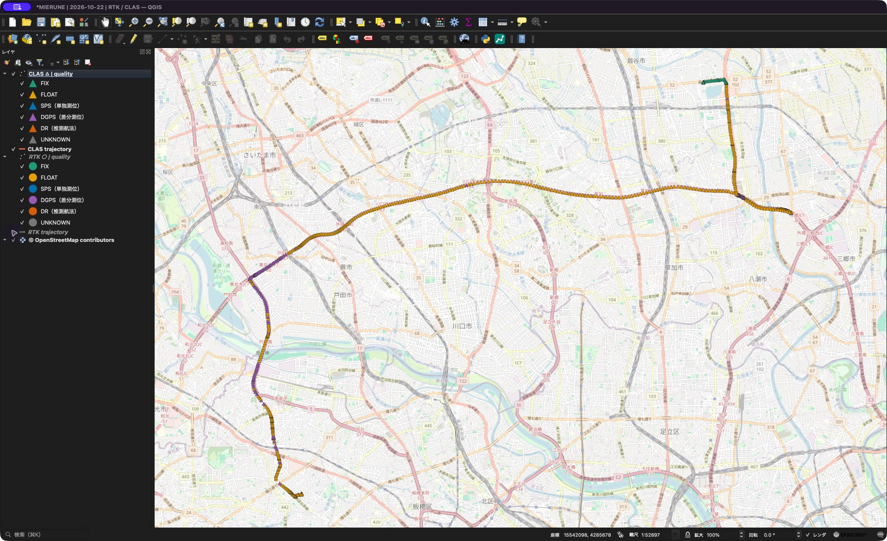
*同じ範囲・縮尺で表示したCLAS側の有効点924点。地図：[© OpenStreetMap contributors](https://www.openstreetmap.org/copyright)。*

### QGISで見るときの表現

発表時の保存データでは、RTKを丸、CLASを三角にしました。色はFIXが緑、FLOATが黄、SPSが青、DGPSが紫です。形で受信機、色で測位状態を区別しています。

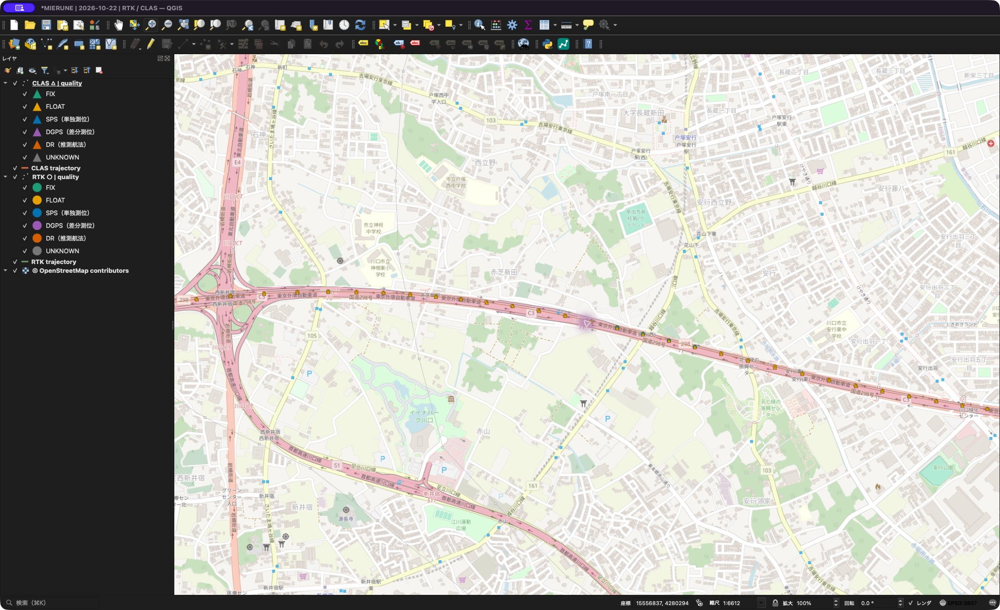
*同じ区間を拡大すると、丸と三角の位置や測位状態を見比べられます。地図：[© OpenStreetMap contributors](https://www.openstreetmap.org/copyright)。*

発表の図では、受信機ごとに測位時刻順に点を結びました。途中に無効な位置がある場合と、前の点から測位時刻が5秒を超えて空いた場合は、線を切っています。

## QGISプラグインでの表示

**GNSS Tracks for SORACOM**は、今回の走行ログを解析するために整備したQGISプラグインです。インストールと接続設定の手順はGitHubにまとめています。

https://github.com/takao2704/qgis-soracom-tracks

1. RTK側とCLAS側のSIM、取得期間を選んでHarvestから取得します。点と、受信機ごとの軌跡がまとめて追加されます。
2. 車載したソラカメを選び、**地図上の点を選択**を押します。地図を動かすパンツールから、点を選ぶ十字カーソルに切り替わります。
3. 地図上の点をクリックすると、その測位時刻に対応する画像を表示します。保存済みならキャッシュを使い、未保存なら設定に応じてAPIから取得します。

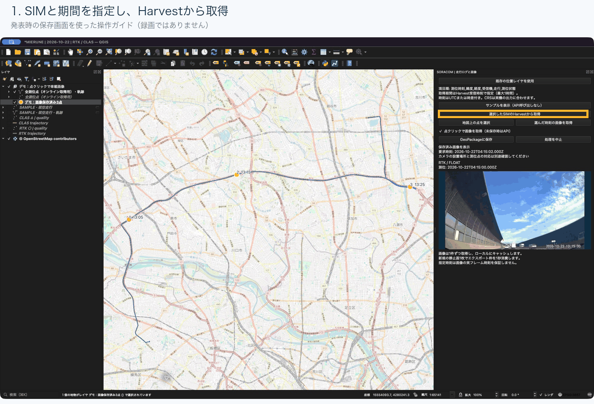
*発表時のスクリーンショットを操作順に並べたGIFです。現行版とは名称や配置が一部異なります。地図：[© OpenStreetMap contributors](https://www.openstreetmap.org/copyright)。*

位置情報だけでも利用できます。画像を見る場合は、対象時刻のクラウド録画とエクスポート権限が必要です。現在のカメラがオフラインでも、録画がクラウドに残っていれば過去の画像を取得できる場合があります。

:::message
Harvestの取得期間は到着時刻`received_at`、軌跡の順序や画像を探す起点は測位時刻`measured_at`です。遅れて届いたログを含めるには、取得期間を広めに取ります。
:::

## ソラカメとの時刻合わせ

位置と映像を結び付けるのは時刻です。車載したATOM Cam 2は走行中の映像をクラウドに録画し、トラッカーは各地点を通った時刻を位置ログに残します。QGISで地図上の点をクリックすると、プラグインは**その点の測位時刻**を取り出し、選んだカメラの録画から画像を探します。

デモでは、13:15:00の測位点を選び、録画から画像を探す時刻に2秒足して**13:15:02**を指定しました。取り出した画像の時計は**13:15:00**を示していました。ログには元の測位時刻がそのまま残ります。+2秒はこのデモで使った設定です。

画像の自動取得がオンで、まだ手元に画像がなければ、プラグインは**カメラと時刻を指定して、録画から静止画を1枚切り出すようAPIに依頼**します。APIはまず、その切り出し処理に付けた `exportId` を返します。プラグインはこのIDで完了を確認してから画像をダウンロードし、QGISに表示します。同じカメラの同じ時刻をもう一度選んだときは、保存済みの画像を表示します。

実走デモでは13:05、13:15、13:25の3地点をこの方法で開きました。測位状態が変わった場所を地図で選ぶと、そのとき車の周りに何があったかを録画でも見返せます。

## データからわかること

**車の前と後ろに置いた2台の位置を結ぶと、駐車場で車体の向きが変わっていく様子が見えました。**

まず、切り返しの場面で軌跡と車体の向きを見比べます。続いて、走行中は進行方向とどれくらい角度が違ったか、停止中はどれくらい値がばらついたかを見ていきます。

### 車体の向きを確認することはできるのか

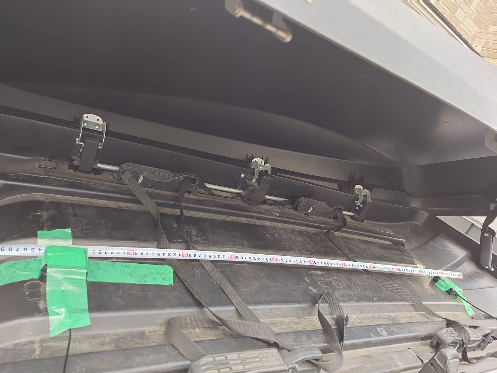
*メジャーで取り付け間隔を確認。約110cm離して固定しました。*

アンテナは前側がCLAS、後ろ側がRTKで、取り付け間隔は約110cmです。そこで、**後ろのRTKから前のCLASへ向かう線**の方位を計算しました。

対象は、両方が[FIX](./gnss-rtk-clas-glossary#fix)で、[NMEA](./gnss-rtk-clas-glossary#nmea)上の測位UTCが一致する41組です。13:44:50〜13:48:10 JSTの、5秒間隔で連続した記録でした。各時刻に記録された位置をそのまま使い、後ろから前へ引いた線の角度を求めました。

この方法では、車が止まっていても前後2点の間隔が残るので、向きを求められる可能性があります。一方、移動の方向は停止中には定まりにくく、後退中には車体の前向きと逆になります。そこで、受信機が出力した「進行方向」は、走行中の向きの変化を比べる目安にしました。

### 駐車時の切り返し

車の向きがいちばん分かりやすかったのは、最後に駐車場で切り返したところです。下の図は13:47:30〜13:48:10の9組で、すべて両方FIXです。実線はそれぞれのアンテナが移動した跡、破線の矢印は同じ時刻の後ろのRTKから前のCLASを結んだものです。13:47:50からの10秒間に注目してみてください。

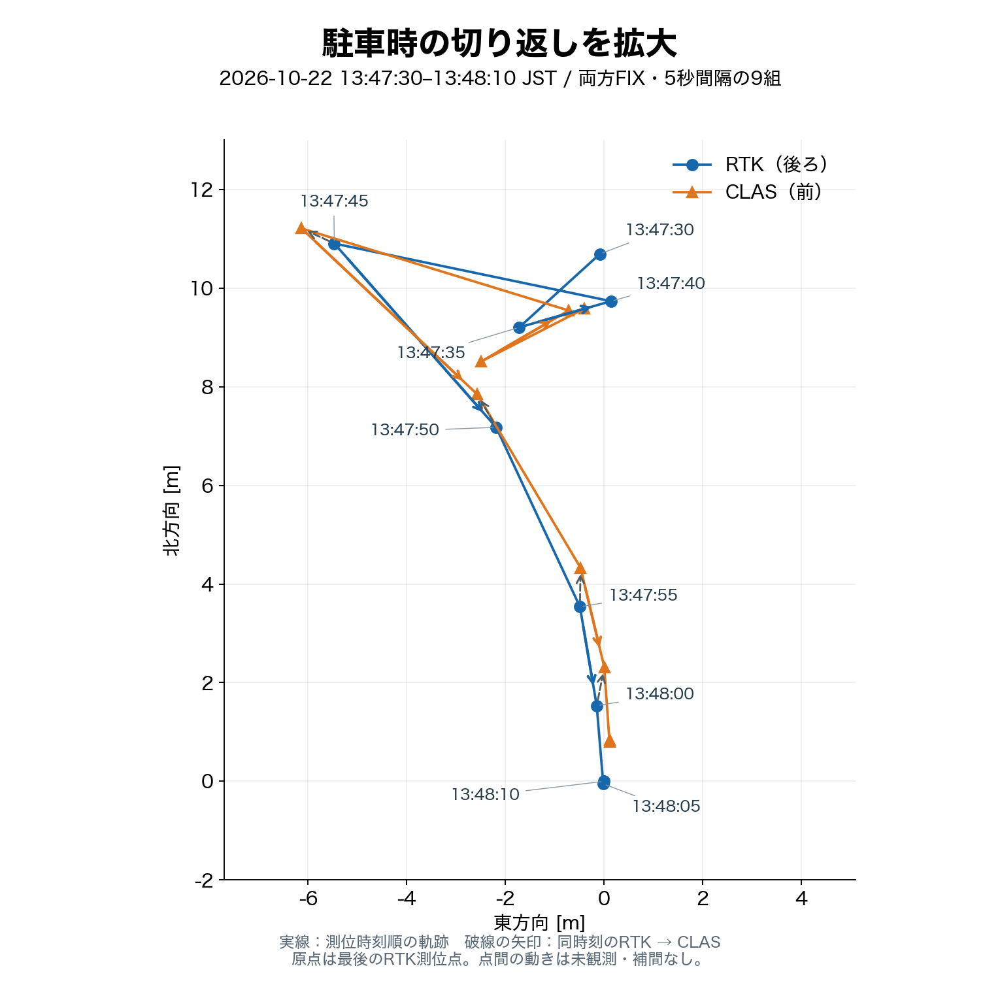

前後のアンテナはどちらも南へ動いています。ところが、後ろの点から前の点に引いた矢印は北寄りを向いています。車の前を北寄りに向けたまま、南へバックしたと読むことができます。

同じ9組をQGISで地図に重ねてみました。左が周辺の道路との位置関係、右が駐車場を拡大したところです。

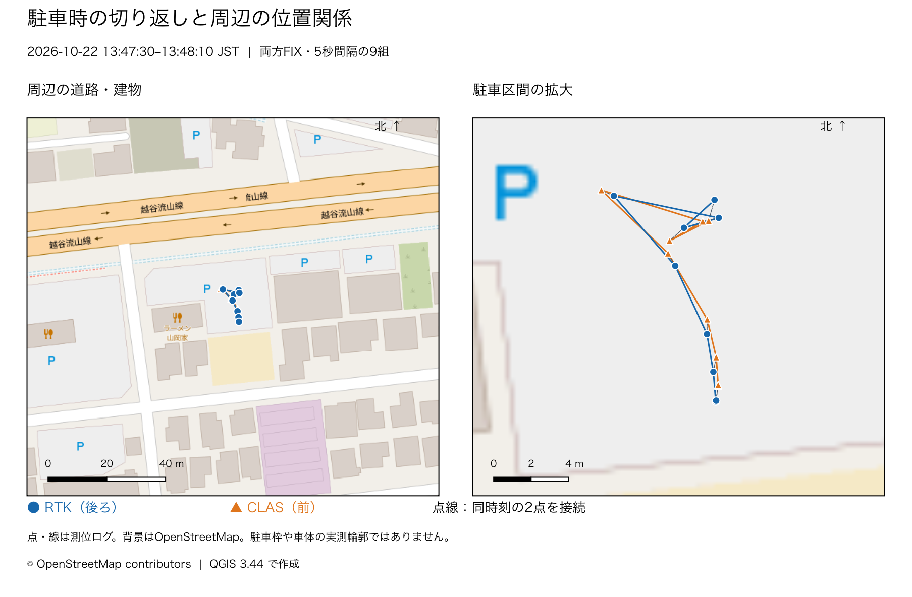
*青丸が後ろのRTK、橙の三角が前のCLASです。測位した座標をそのまま地図に重ねています。周辺の道路や建物を目印に、駐車場のどのあたりで切り返したかを見てください。地図：[© OpenStreetMap contributors](https://www.openstreetmap.org/copyright)。*


実際に停めた駐車スペースの位置関係を思い返しても、この動きは合っていそうです。

### 前後2点の方位と進行方向

では、何度向きを変えたかまで読めるでしょうか。今度は駐車の手前、13:45:45〜13:47:20の走行に注目します。下の図の上段で、前後2点を結んだ線の向きと、RTKが記録した進行方向を見比べてみます。

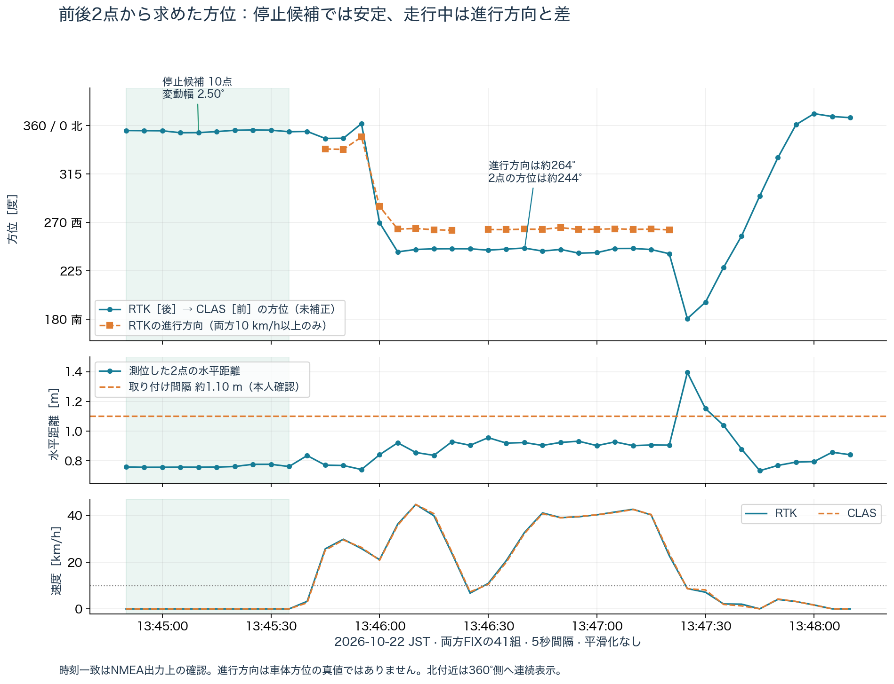
*青が前後2点から求めた方位、橙が両方10km/h以上でのRTKの進行方向です。NMEA上の測位時刻をそろえていますが、受信機内部の時間応答まで一致するかは未確認です。*

グラフを見ると、北西寄りから西寄りへ大きく向きが変わる様子は、どちらにも表れています。ただ、方位の数値には差がありました。

| 区間 | 前後2点から求めた方位の平均 | RTKの進行方向の平均 |
| --- | ---: | ---: |
| 13:45:45〜13:45:50の2点 | 約348.2度 | 約338.1度 |
| 13:46:05〜13:47:20の16点 | 約244.3度 | 約263.6度 |

**前後2点を結んだ線の平均方位は、2つの区間で約104度変わりました。** 同じ区間で、RTKが捉えた進行方向の変化は約74度です。

ここで求めた104度は、地図に描いた線の角度から出した値です。アンテナの間隔は約110cmなので、仮に車体の向きが同じでも、片方の測位点が真横に10cmずれると線の角度は約5度変わります。

車体そのものが何度向きを変えたかを確かめるには、同じ時刻の車体の向きをもう一つの方法で記録しておきたいです。たとえば車体に固定して校正した慣性計測装置（IMU）で向きの変化を記録し、GNSSと時刻をそろえます。表と同じ2点と16点でそれぞれ平均を取れば、実際の変化量と104度を比べられます。

また、両受信機の速度が10km/h以上の19点では、2点の方位とRTKの進行方向との差の絶対値は、中央値で約18.3度ありました。CLASの進行方向や軌跡から求めた方向と比べても、同程度の差が残ります。

### 停止中の方位の安定性

両受信機の出力速度が0.1km/h以下で、5秒間隔の記録が3点以上続くところを「停止候補」としました。該当したのは13:44:50〜13:45:35の10点、45秒間です。

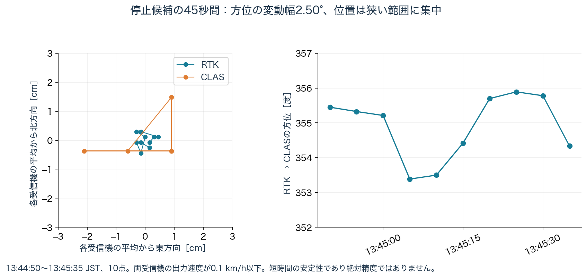
*左図は、RTKとCLASそれぞれの平均位置を原点にそろえています。原点の周りで点がどれくらい動いたかを比べる図です。*

| 確認した値 | 結果 |
| --- | ---: |
| 前後2点から求めた方位の平均 | 約354.9度 |
| 方位の最大値と最小値の差 | 約2.50度 |
| 方位の標準偏差 | 約0.88度 |
| RTKの平均位置からの最大距離 | 約0.47cm |
| CLASの平均位置からの最大距離 | 約2.14cm |
| 前後2点の水平距離 | 約0.757〜0.777m |

この区間では、位置が狭い範囲に集まり、2点を結ぶ線の向きも安定していました。発表で話した「止まっていることが分かる」を考えるうえで、具体的な手がかりになりました。

約2.5度は、この45秒間で方位の値が動いた幅です。仮に実際の車体方位から一定のずれがあっても、値は同じように安定します。また、点のまとまり方には、受信機のフィルタや座標の出力桁数も影響します。

この45秒間は、GNSSの速度から選んだ「停止候補」です。実際に停車していたかを確かめるには、GNSSとは独立した記録が必要です。たとえば同じ45秒間の車載映像で、路面の白線や標識が画面内の同じ位置に映り続けているかを見れば、5秒ごとの測位の合間も含めて照合できます。

### アンテナの取り付け間隔と測位点の距離

メジャーで測ったアンテナの取り付け間隔は約1.10mです。両方がFIXだった41組で、測位点同士の水平距離を求めると約0.73〜1.39m、中央値は約0.84mでした。停止候補の区間でも約0.76mです。取り付け間隔はおおよその値ですが、両方がFIXの間にも、ログから求めた距離にはこれだけ幅がありました。

前後の位置にずれがあれば、2点を結ぶ線の向きも変わります。今回のような約1mの間隔では、相対位置の横方向のずれが10cm程度でも、角度に数度の違いが出ます。距離が一定に見える場合も、線全体が誤った方向を向いている可能性は残ります。

### 測位時刻と受信機の応答

時速40kmで走っていると、実効的な時間差が0.1秒あれば約1.1m進みます。今回のアンテナ間隔と同程度です。

元のNMEAを確認すると、41組すべてで[RMC](./gnss-rtk-clas-glossary#rmc)/[GGA](./gnss-rtk-clas-glossary#gga)のUTCが一致し、保存した`measured_at`とも一致していました。たとえばRTKは`044610.000`、CLASは`044610.00`です。表記の桁数は違っても、端数秒まで照合すると同じ時刻でした。

NMEAのGGAにあるUTCは位置解の時刻で、Raspberry Piに届いた時刻やHarvestに届いた時刻とは違います。[GGAの時刻フィールドの定義](https://help.fieldsystems.trimble.com/r580/nmea0183-messages-gga.htm)

**ログ上の測位時刻は41組ともそろっています。** 残る疑問は、走行中の動きが2台の位置に同じタイミングで表れたかどうかです。今回の5秒間隔の記録では、受信機の応答の遅れと位置そのもののずれを切り分けられませんでした。補足では、それぞれを仮定したときに観測結果をどこまで説明できるかを比べます。

:::details 補足：対象データと方位の計算方法

各受信機で同じ`event_id`の最初の受信記録を残し、`measured_at`が完全に一致するRTKとCLASの記録だけを組にしました。

| 条件 | 時刻の組数 |
| --- | ---: |
| 両方に同じ測位時刻の記録がある | 927組 |
| そのうち、両方に有効な位置がある | 922組 |
| そのうち、両方ともFIX | 41組 |

WGS 84楕円体上で高さを0として地心座標へ変換し、CLASとRTKの座標差をRTK側の局所的な東・北方向へ投影しました。その水平距離と方位を求めています。

```text
東西の差 ΔE = 前側CLASの東方向座標 − 後側RTKの東方向座標
南北の差 ΔN = 前側CLASの北方向座標 − 後側RTKの北方向座標
方位 = atan2(ΔE, ΔN) を度に直し、0〜360度へそろえる
```

北を0度、東を90度とする方位です。先に座標差を東・北方向のメートルに換算することで、緯度と経度の1度が表す長さの違いを考慮できます。投影座標を使って求める場合は、地図上の北と真北の違いにも注意します。

| 対象 | 水平距離の最小 | 中央値 | 最大 |
| --- | ---: | ---: | ---: |
| 両方に有効な位置がある922組 | 約0.07m | 約1.17m | 約24.12m |
| 両方ともFIXの41組 | 約0.73m | 約0.84m | 約1.39m |

表は、同じ時刻の前後2点が水平方向に何m離れていたかを示しています。計算に使ったのは東西と南北の成分です。

両方の位置が得られた922組では、同じ車に取り付けた2台の間隔が、ログ上は最大約24mまで開いています。そこで方位の分析は、両方がFIXだった41組に絞りました。

走行中の比較には、両受信機の出力速度が10km/h以上の19点を使いました。2点の方位との差の絶対値の中央値は、RTKの進行方向で約18.3度、CLASの進行方向で約18.3度、前後5秒ずつの軌跡方向で約18.9度でした。RTKの進行方向を参照した95パーセンタイルは約22.1度です。

低速・停止時には進行方向が保持されたり不安定になったりするため、この比較から外しました。終盤の駐車区間では2点の方位と進行方向が逆向きになる点もあります。この並びは、駐車区間の拡大図で見た後退の動きと整合します。

:::

:::details 補足：アンテナ間隔と位置のずれが角度に与える影響

2点の位置がそれぞれ揺れると、2点を結ぶ線も揺れます。同じ横方向のずれでも、アンテナ間隔が短いほど、方位への影響は大きくなります。

たとえば、水平なアンテナ間隔が仮に1mで、2点の相対位置に横方向のずれだけがあるとします。角度への影響は`atan(横方向のずれ / 1m)`で見積もれます。

| 2点の相対位置の横方向のずれ | この仮定での角度のずれ |
| --- | ---: |
| 1cm | 約0.6度 |
| 10cm | 約5.7度 |
| 50cm | 約26.6度 |

表の角度は、2点の相対位置に仮のずれを与えて計算した値です。たとえば2点が同じ向きに同じだけずれると、そのずれは差を取るときに相殺されます。方位に効くのは、前後の点が互いにどちらへどれだけずれるかです。

この取り付け方で方位の精度を評価するには、アンテナ中心間の距離と取り付け角を測ったうえで、同じ時刻の前後2点から求めた方位を既知の方位と比べます。
:::

:::details 補足：位置ずれ・時間差モデルで検討したこと

ここでは、前後2点から求めた方位と進行方向の開きを、位置のずれや時間差でどこまで説明できるか試しました。

前進中には車体の向きと進行方向が一致し、水平なアンテナ間隔が1.10mであると仮定して、期待される前後ベクトルを計算しました。それと実際のベクトルとの差を19点で求めると、平均は東へ約26.7cm、南へ約27.8cmでした。差の東・北成分の標準偏差は、それぞれ約2.9cmです。

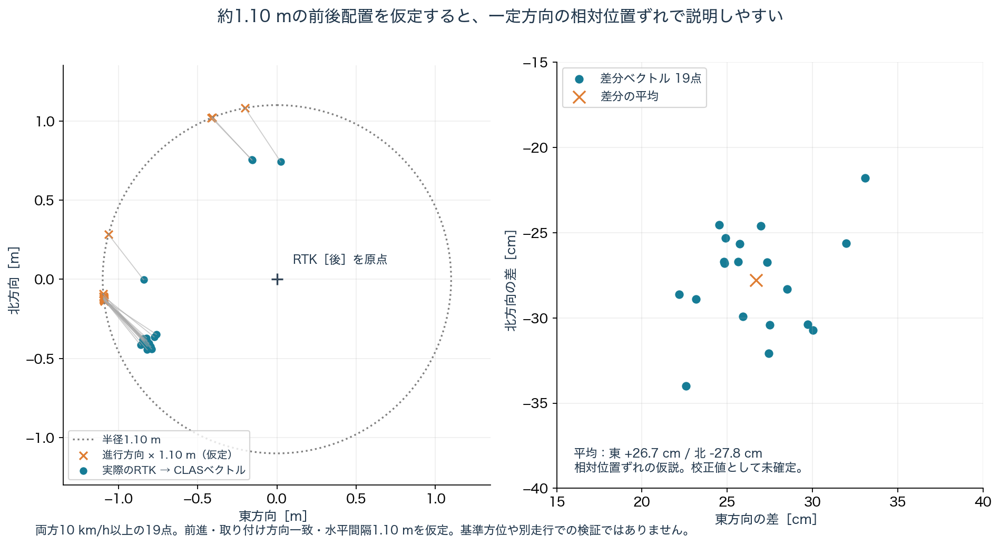
*車体が進行方向を向いて前進し、アンテナが水平方向に1.10m離れていると仮定して、実測の前後ベクトルと比べています。*

2台の相対位置に、東南方向へ約39cmの一定のずれがあると考えると、距離が短く見えることと、方位によってずれ方が変わることを説明しやすくなります。ここで推定した約39cmは、前後2台を組にしたときの相対的なずれです。

試しに、西寄りの進行方向260〜270度にある15点だけから差分を求め、それ以外の4点へ同じ差分を仮に引くと、進行方向との差の絶対値は中央値約1.18度、最大約3.28度まで小さくなりました。

約1.18度という値は、同じ走行の残り4点で、進行方向にどれだけ近づいたかを示します。この差分は今回の当てはめにだけ使いました。別の走行でも補正に使えるかを確かめるには、取り付け角と水平間隔を測り、時刻をそろえて既知の車体方位と比べる必要があります。

同じ19点について、一定の時間差だけを仮定する場合と、東・北成分それぞれの一定の位置ずれを仮定する場合も比べました。1.10mの前後ベクトルに、位置差と「速度ベクトル×時間差」を足す簡単なモデルです。

| 当てはめた要素 | ベクトル残差のRMS |
| --- | ---: |
| 一定の時間差だけ | 約29.4cm |
| 東・北成分それぞれの一定の位置ずれだけ | 約4.1cm |
| 東・北成分それぞれの一定の位置ずれと時間差 | 約3.7cm |

一定時間差だけでは、進行方向に対する横方向の差が残ります。停止候補でも距離が短いことと合わせると、この記録では相対位置のずれも含めた説明が合いやすい結果でした。

RMSは、同じ19点にモデルを当てはめたあとに残る位置差の大きさを、二乗平均平方根で表した値です。旋回中のフィルタの遅れなど、時間とともに変わる影響も考えられます。1秒より短い応答の差を調べるには、受信機の測位周期で保存した生ログと設定を照合したいところです。
:::

### 結局、空がちゃんと見えていることが大事

前後2台の向きを調べる場合も、停止を見分ける場合も、安定した観測が必要です。アンテナから空が見えているか、建物や高架などによる遮蔽・反射がないかを確認することが、その前提になります。[NovAtelのアンテナ設置ガイド](https://docs.novatel.com/OEM7/Content/Core_Installation/Mounting_GNSS_Antenna.htm)でも、空の見通しとアンテナの固定が挙げられています。

今回、静止確認では両方ともFIXが続いていましたが、走行中には測位状態が変わりました。ここでソラカメの画像を合わせると、状態が変わった付近の周囲の様子を見返せます。

高速道路では、真上が開けていても、両側の防音壁が低い角度の空を遮ることがあります。車載画像からは壁や高架の位置を見返せます。そこで気になったのは、走っていたとき、その方向にどの衛星がいたかです。

### 当時の衛星配置との照合

走行中に保存したNMEAを調べると、RTKの937件、CLASの930件に入っていたのは[GGA](./gnss-rtk-clas-glossary#gga)と[RMC](./gnss-rtk-clas-glossary#rmc)でした。GGAからは使用衛星数や[HDOP](./gnss-rtk-clas-glossary#hdop)を読み取れます。**衛星ごとの番号や方位を照合するための[GSV](./gnss-rtk-clas-glossary#gsv)・[GSA](./gnss-rtk-clas-glossary#gsa)が残っていたのは、走行前のRTK側だけでした。**

そこで、当日の公開軌道データと走行ログを使い、[GPS](./gnss-rtk-clas-glossary#gps)と[みちびき](./gnss-rtk-clas-glossary#qzss)が空のどこにいたかを計算してみました。ソラカメの画像を確認した13:05、13:15、13:25の3時点を選んでいます。軌道データは[BKGが公開する2026年10月22日の放送暦](https://igs.bkg.bund.de/root_ftp/IGS/BRDC/2026/295/)を使いました。

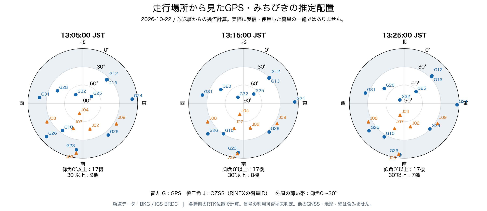
*円の中心が真上、外周が地平線です。外周に近い衛星ほど、低い角度の空にあります。薄い帯は、仰角30度未満の衛星を見つけやすくするための目盛りです。*

たとえば13:15の位置では、GPSのG24はほぼ東の仰角約6度、G23は南寄りの約9度にいました。こうした低い衛星は、上空が開けていても周囲の壁に隠れる可能性があります。**空が見えるかどうかは、真上だけでなく、衛星がいる方向まで見る必要がある**と分かります。

今回の図で再現できたのは、走行地点から見た衛星の方向です。次のドライブでは、防音壁のある区間に入る前から抜けたあとまで、2台で衛星ごとの信号の強さと測位に使った衛星番号を記録してみたいです。車載映像で壁のある側を確かめ、当時の衛星配置と重ねます。壁の方向にいた低い衛星で信号が弱くなったり、測位に使われなくなったりした時刻と、FIXやFLOATが切り替わった時刻を比べるつもりです。

:::details 補足：衛星配置の計算条件

各時刻のRTKの緯度・経度と高さを観測点として、GPSとQZSSの放送暦から方位・仰角を計算しました。[ESAの衛星座標の計算式](https://gssc.esa.int/navipedia/index.php/GPS_and_Galileo_Satellite_Coordinates_Computation)と[みちびきのインタフェース仕様](https://qzss.go.jp/en/technical/download/pdf/ps-is-qzss/is-qzss-pnt-006.pdf)を参照しています。UTCとGPS時刻の差は放送暦ヘッダーの18秒を使い、軌道基準時刻から2時間以内のデータを選びました。

図中の機数は、GPSとみちびきのうち、軌道計算で各仰角の条件に入った衛星の数です。衛星の健全性や信号の利用可否にかかわらず数えています。CLASのL6信号を実際に受信したかを調べるには、対応する受信機のログが必要です。

計算方法は、走行前にRTK側が記録したGPS・みちびきのGSVで検算しました。方位と仰角を照合できた19項目では、計算値と受信機の出力との差はいずれも1度未満でした。
:::

:::details 次回残したい衛星ごとの記録

NMEAの[GSV](./gnss-rtk-clas-glossary#gsv)には衛星番号・仰角・方位・信号強度、[GSA](./gnss-rtk-clas-glossary#gsa)には測位に使用した衛星の番号などが入ります。番号はGPSなどの衛星システムとセットで扱います。測位に使われた衛星を調べるときは、GSVの一覧とGSAの番号を突き合わせます。フィールドの意味は[受信機メーカーによるGSVの説明](https://receiverhelp.trimble.com/oem-gnss/nmea0183-messages-gsv.html)と[GSAの説明](https://receiverhelp.trimble.com/oem-gnss/nmea0183-messages-gsa.html)も参考になります。

次回はGGA・RMCに加え、GSV・GSAを受信時刻付きで保存します。機器が出力できる場合は、衛星ごとの使用状態や搬送波追尾の情報も残します。全メッセージをローカルに保存し、クラウドには必要な集計だけを送る構成なら、通信量も抑えられます。

今回、検算に使ったGSVは、走行前の10:10〜10:59 JSTにRTK側で受信した記録から取り出しました。
:::


## まとめ

RTKとCLASの走行ログをQGISに読み込み、地図上の点の測位時刻を使ってソラカメ画像を開けるようにしました。これで、地図上でFIXからFLOATに変わった場所を選び、そのとき車の周りに何があったかを振り返れます。

駐車時には、前後のアンテナの軌跡が南へ延びる一方で、後ろのRTKから前のCLASを結ぶ線は北寄りを向いていました。実際に停めた場所と照らすと、バックで駐車する動きに合っています。**向きの変化は見えるけれど、そのまま正確な方位とは言えない。** ここが、両方ともFIXだった41組から分かったことです。

高精度な位置が得られると、移動の軌跡に加えて、止まっていることや向きの変化にも目を向けられます。そして、そのためにも**結局、空がちゃんと見えていることが大事**です。今回作った記録と表示の仕組みを使って、次はその条件と結果をもう少し細かく確かめていきます。

プラグイン「GNSS Tracks for SORACOM」のソースと導入手順は、次のリポジトリで公開しています。まずは手元の位置ログを読み込んで、気になった点の映像を開いてみるところから試してもらえればと思います。

https://github.com/takao2704/qgis-soracom-tracks
