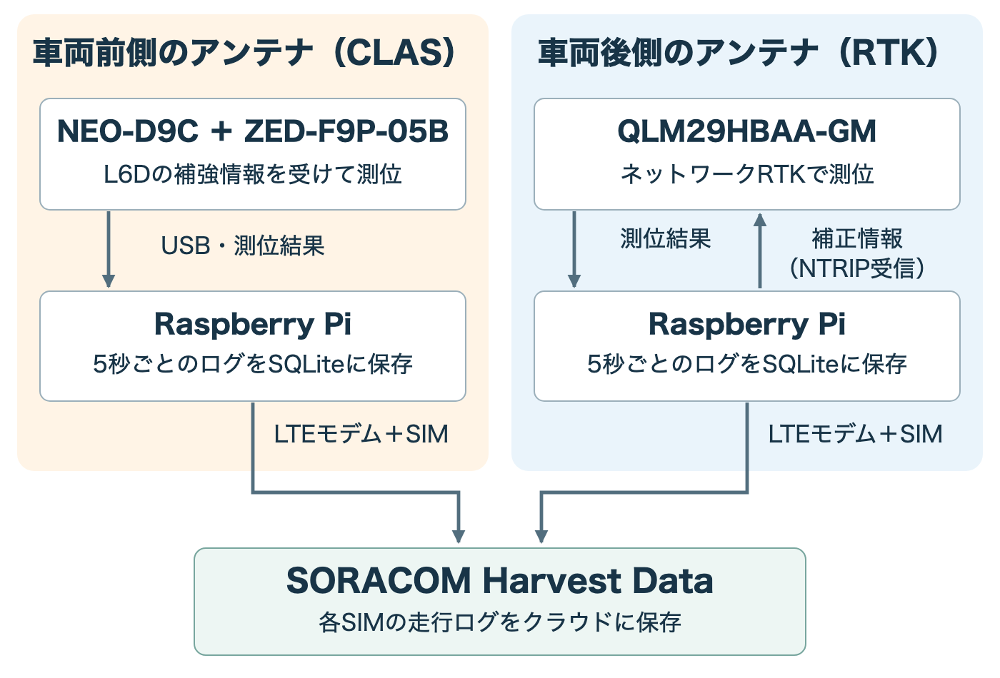
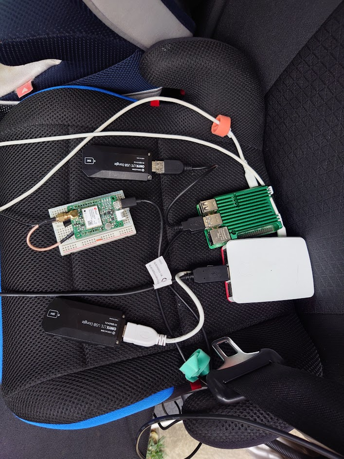
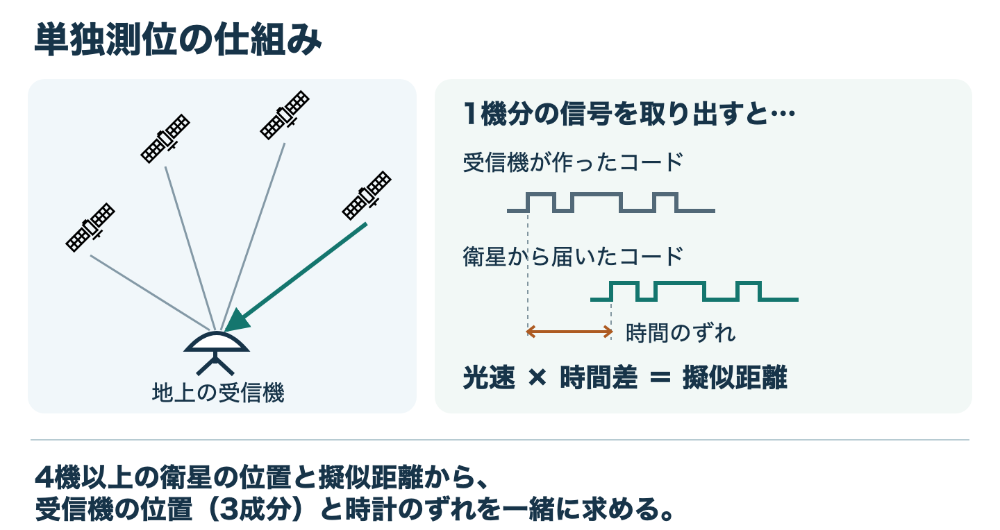
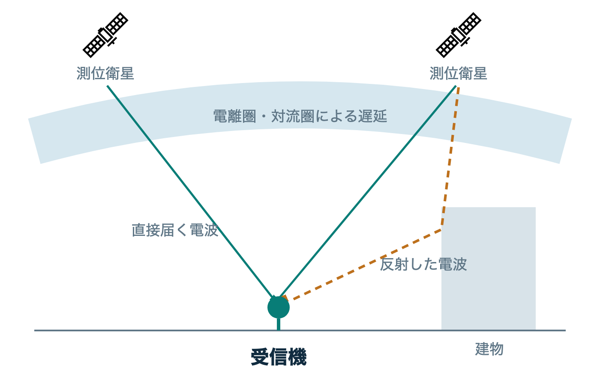
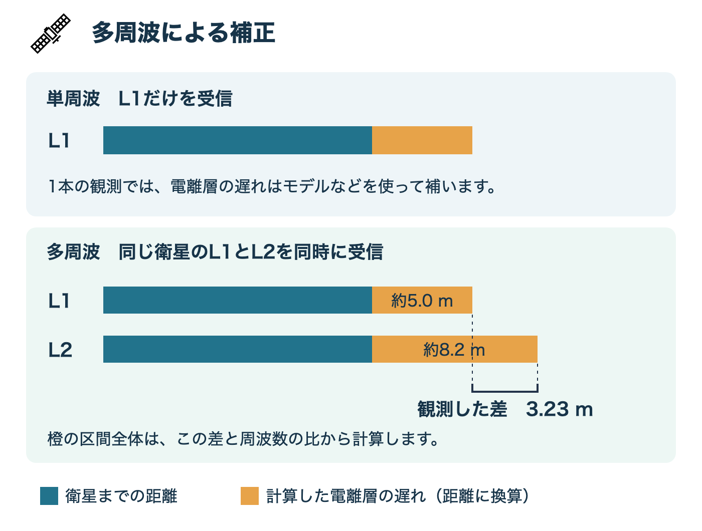
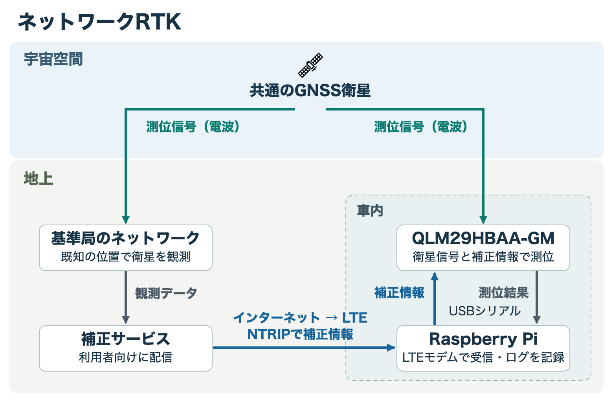
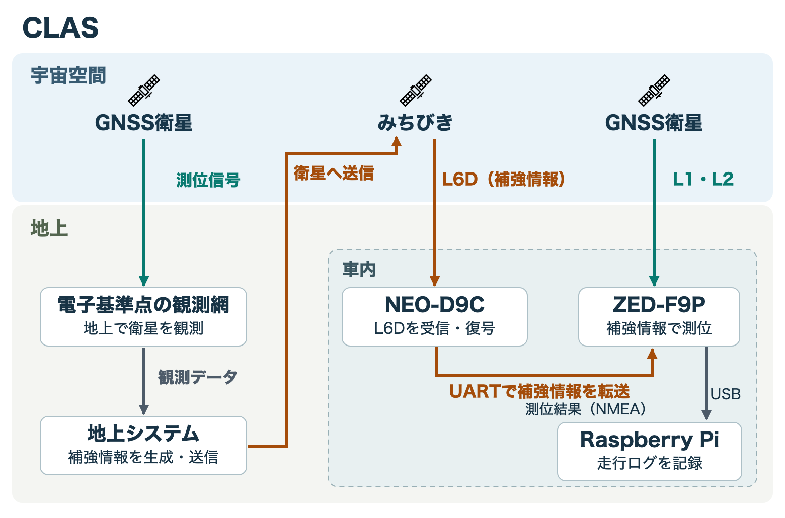
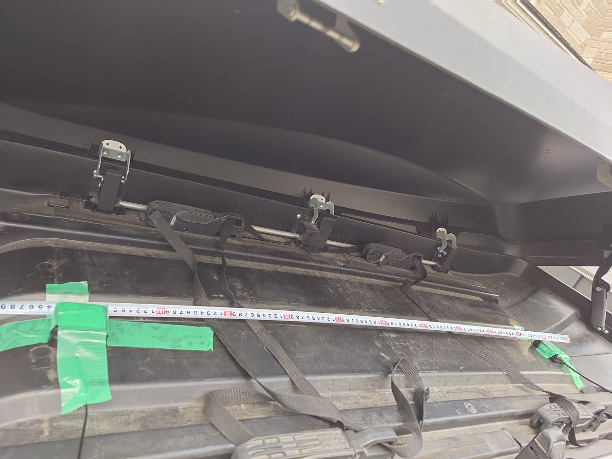
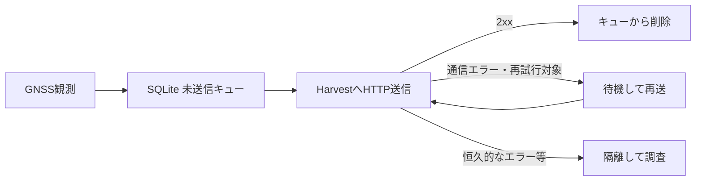

:::message
「[一般消費者が事業者の表示であることを判別することが困難である表示](https://www.caa.go.jp/policies/policy/representation/fair_labeling/guideline/assets/representation_cms216_230328_03.pdf)」の運用基準に基づく開示: この記事は記載の日付時点で[株式会社ソラコム](https://soracom.jp/)に所属する社員が執筆しました。ただし、個人としての投稿であり、株式会社ソラコムとしての正式な発言や見解ではありません。
:::

## はじめに

昨年の12月、[みちびき](./gnss-rtk-clas-glossary#qzss)の[CLAS](./gnss-rtk-clas-glossary#clas)を使った[GNSS](./gnss-rtk-clas-glossary#gnss)トラッカーを作って、車に載せて走ってみました。今回はそこに、ネットワーク[RTK](./gnss-rtk-clas-glossary#rtk)を使うトラッカーをもう1台追加しました。

https://zenn.dev/takao2704/articles/qzss-cm-level-gnss-tracking

同じ車に2台も載せて何を見たいのかというと、車の向きです。本当にcm級の高精度で測位ができるなら、車が止まっていても向きが分かるんじゃないか。アンテナを前後に1個ずつ付けて、後ろの測位点から前の測位点に線を引けば、その線が車の前を向くはずです。そう思って、前にCLAS、後ろにRTKのアンテナを約110cm離して取り付けました。

この記事は、[2026年10月22日のMIERUNE JCT in Tokyo](https://mierune.connpass.com/event/405920/)でお話しした内容の前編です。まずは2台のRaspberry Piで位置を記録して送り、あとから同じ時刻の点を取り出せるようにするところまでを紹介します。[後編](./gnss-rtk-clas-qgis-soracam)では、駐車場で切り返したときのデータをQGISで見ながら、前後の測位点から車の向きをどこまで読み取れるか評価します。

@[card](https://speakerdeck.com/takao2704/jisaku-gps-to-qgis-deno-soukou-deta-kashika)

測位方式や受信機の略語は、[高精度GNSSトラッキング関連用語集](./gnss-rtk-clas-glossary)にまとめました。

## トラッカーの構成

RTK側とCLAS側に1台ずつ、合計2台のRaspberry Piを使います。それぞれにGNSS受信機とLTEモデムをつなぎ、受信機が計算した位置をRaspberry Piで読み取ります。


*左右の列がそれぞれ独立したトラッカーです。2台のログは、あとから測位時刻でそろえます。*

| 構成 | RTK側 | CLAS側 |
| --- | --- | --- |
| 測位受信機 | Quectel [QLM29HBAA-GM](./gnss-rtk-clas-glossary#qlm29hbaa-gm) | [F9PX1](./gnss-rtk-clas-glossary#f9px1) / u-blox [ZED-F9P](./gnss-rtk-clas-glossary#zed-f9p) |
| 補正・補強情報 | インターネット上の[NTRIP](./gnss-rtk-clas-glossary#ntrip)配信サービス | [D9CX1](./gnss-rtk-clas-glossary#d9cx1) / u-blox [NEO-D9C](./gnss-rtk-clas-glossary#neo-d9c)でみちびきの[L6D](./gnss-rtk-clas-glossary#l6d)を受信 |
| 記録と送信 | Raspberry Pi | Raspberry Pi |
| クラウドへの通信 | LTEモデムとSORACOM IoT SIM | LTEモデムとSORACOM IoT SIM |
| 保存先 | 端末のSQLiteを経由し、SORACOM Harvest Dataへ送信 | 同左 |

GNSS受信機が位置を計算し、Raspberry Piが記録・送信を担当します。保存先のSORACOM Harvest Dataは、端末から送ったデータをクラウドに蓄積し、APIなどで読み出せるサービスです。RTK側のRaspberry Piは、補正情報を受信機へ渡す役割も持ちます。


*車内に置いたトラッカー。2台のRaspberry Piから、それぞれLTEモデムを使って送信します。*

## GNSS測位の原理

### 衛星の位置と電波の到達時間

普段は[GPS](./gnss-rtk-clas-glossary#gps)と呼ぶことが多いですが、衛星測位システム全体を指す言葉は[GNSS](./gnss-rtk-clas-glossary#gnss)（Global Navigation Satellite System）です。GPSはそのうちの1つで、ほかにもGalileoや、日本の[みちびき](./gnss-rtk-clas-glossary#qzss)などがあります。

今回のトラッカーがどうやって位置を求めているのか、まずは普通の[単独測位](./gnss-rtk-clas-glossary#sps)から見てみます。下の図で、緑の矢印は1機の衛星から受信機に届く信号です。


*右の波形は、同じコードの一部を同じ時間軸に並べたものです。山と谷の並びは同じで、届いた方が右にずれています。*

受信機は衛星ごとに決まったコードを手元でも作り、受信したコードとぴったり重なるまでずらします。こうして調べた到達時間に光速を掛けると、衛星までの距離を見積もれます。衛星と受信機の時計のずれも含むので、この値を**擬似距離**と呼びます。[コードから擬似距離を求める仕組み（ESA）](https://gssc.esa.int/navipedia/index.php/GNSS_Basic_Observables)

衛星が信号を送ったときにどこにいたかは、その衛星が放送する軌道情報から計算できます。通常の3次元測位では、空の異なる方向にある4機以上の衛星について、衛星の位置と擬似距離を組み合わせます。これで受信機の位置（3成分）と、受信機の時計がどれだけずれているかを一緒に求めます。

実際の空では、電波が大気を通るときに遅れたり、建物に反射して遠回りしたりします。どちらも、受信機が測る距離に影響します。


*実線は直接届く電波、破線は建物で反射して届く電波です。衛星の数と配置は簡略化しています。衛星アイコンは[SORACOM Icon Set](https://design.soracom.io/design-system/images/icons/)を使用しました。*

衛星測位の基本は、[みちびきの衛星測位サービスの解説](https://qzss.go.jp/overview/services/sv04_pnt.html)も参考になります。

### 多周波、搬送波、外部の補正情報

高精度な測位では、主に次の技術を組み合わせます。

**多周波の観測**で何が分かるのか、同じ衛星から届く信号を例に見てみます。電波が電離層を通ると、受信機に符号が届くのが少し遅れます。届くまでの時間で距離を測ると、この遅れの分だけ衛星が遠く見えます。


*下段のかっこは、L1とL2で測った擬似距離の差（例では3.23 m）です。橙の区間は、その差から計算した各信号の遅れを拡大して示しています。*

[L1](./gnss-rtk-clas-glossary#l1)だけの場合、受信機は電離層のモデルなどを使って遅れを補います。同じ衛星の[L2](./gnss-rtk-clas-glossary#l2)も同時に測れば、図の青い部分（衛星までの距離）は共通です。2本の棒の長さを引き算すると、橙の部分の差が残ります。

では、その差から橙の部分全体の長さがどうやって分かるのでしょうか。コードに生じる電離層の遅れは、一次近似では**周波数の2乗に反比例**します。L1は1575.42 MHz、L2は1227.60 MHzなので、L2の橙の部分はL1の約1.647倍です。つまり、**2本の差はL1の橙の部分の約0.647倍**に当たります。[電離層による遅れの解説（ESA）](https://gssc.esa.int/navipedia/index.php/Ionospheric_Delay)

たとえば、ほかの誤差を省いた図の例で、L2の方が3.23 m長く測れたとします。L1の遅れは距離に換算すると **3.23 ÷ 0.647 ≈ 5.0 m**、L2の遅れはそれに3.23 mを足して約8.2 mです。L1で測った擬似距離から約5.0 mを引けば、電離層で長く見えた分を補正できます。

今回のCLAS側はL1とL2、RTK側はL1と[L5](./gnss-rtk-clas-glossary#l5)の組み合わせです。L1とL5でも考え方は同じで、計算にはその2つの周波数を使います。

**搬送波の位相の観測**では、衛星から届いた波を、受信機の中で作った基準の波と比べます。受信機は、基準の波と、それをちょうど4分の1周期ずらした波の両方を使います。届いた波がそれぞれにどれだけ重なるかを測ると、その2つの値から、基準の波に対して何度進んでいるか、遅れているかが分かります。この角度が**位相差**です。[受信機が位相を追いかける仕組み（ESA）](https://gssc.esa.int/navipedia/index.php/Phase_Lock_Loop_%28PLL%29)

たとえばGPSの[L1](./gnss-rtk-clas-glossary#l1)信号は、1周期（360度）が約19cmに相当します。位相が36度変われば、その10分の1なので、距離に換算して約1.9cmです。

ただ、36度でも、丸1周した396度でも、波の重なり方は同じです。受信を始めたとき、衛星から受信機までに丸々何周期分の波が収まっているかは、別に求める必要があります。この最初は分からない整数の個数を、**整数曖昧性**と呼びます。

ここでは波の個数として説明しました。実際の計算では時計や大気などの影響も扱い、複数の衛星の観測と補正情報を組み合わせて、この整数を推定します。[搬送波の位相と整数曖昧性の解説（NovAtel）](https://novatel.com/an-introduction-to-gnss/resolving-errors/pseudorange-carrier-phase)

**外部の補正情報**は、衛星の時計や軌道、大気の影響などを補うために使います。受信機自身の観測と組み合わせて、より精密に位置を求めます。

多周波対応の受信機を使うだけで、いつでもcm級の位置が得られるわけではありません。受信環境や補正情報の状態も含めて、この組み合わせが成立する必要があります。

### FIXとFLOATの読み方

先ほどの「何周分か」という整数の候補を確定して位置を求めた状態が[**FIX**](./gnss-rtk-clas-glossary#fix)です。整数としてはまだ確定せず、小数も許した値として推定しながら位置を求めている状態が[**FLOAT**](./gnss-rtk-clas-glossary#float)です。どちらも位置は出ますが、波の個数を整数として決められたか、という違いがあります。

FIXしていても、建物からの反射波などで測位点がずれることがあります。実際に何cmずれたかを確かめるには、FIXでもFLOATでも、測位点を位置の分かっている基準点と比べます。

衛星数や[HDOP](./gnss-rtk-clas-glossary#hdop)（水平精度低下率）も参考になります。HDOPは衛星配置が水平位置の誤差へ与える影響の指標で、値をそのままメートル単位の位置誤差としては読めません。

このほか、今回のログには[SPS](./gnss-rtk-clas-glossary#sps)（単独測位）、[DGPS](./gnss-rtk-clas-glossary#dgps)（差分補正を使う測位）、[DR](./gnss-rtk-clas-glossary#dr)（推測航法）も登場します。DRは、衛星測位の結果だけで位置を求めている状態とは分けて見ます。これらは受信機が出力した状態として保存し、FIXやFLOATと区別して集計しました。

## ネットワークRTK側の構成

今回、Raspberry Piは携帯回線から[NTRIP](./gnss-rtk-clas-glossary#ntrip)で補正サービスに接続し、届いた[RTCM](./gnss-rtk-clas-glossary#rtcm)データを車載受信機に渡します。基準局の観測をどう測位に使うかは、[用語集のRTK](./gnss-rtk-clas-glossary#rtk)にまとめました。


*緑の矢印は、同じ衛星から地上の基準局と車載受信機に届く測位信号です。青い矢印をたどると、地上の補正サービスからインターネットとLTEを通ってRaspberry Piに補正情報が届き、車内のUSBシリアルで受信機に渡ります。*

使用した受信機は、SORACOMで扱っているQuectel製の[QLM29HBAA-GM](https://www.soracom.jp/store/34608/)です。[L1](./gnss-rtk-clas-glossary#l1)/[L5](./gnss-rtk-clas-glossary#l5)帯に対応したGNSS受信機で、Raspberry Pi上のプログラムが受け取った補正データを[USB](./gnss-rtk-clas-glossary#usb)シリアル経由で渡します。QLMが測位した結果は、同じUSB接続から[NMEA](./gnss-rtk-clas-glossary#nmea)として読み取ります。NMEAは、位置や時刻、測位状態などをテキストで出力するための形式です。

補正情報の取得とHarvestへの送信には、GNSS受信機とは別に接続したLTEモデムを使います。

実機では、Raspberry Piが補正データを受け取り、USB経由でQLMに渡すところまで確認しました。配信元がそのデータをどの方式で作ったかは、今回のログからは判別できません。

## CLAS側の構成

こちらは、みちびきの[L6D](./gnss-rtk-clas-glossary#l6d)信号で補強情報を受け取ります。車載側で携帯回線を使うのは、測位ログをHarvest Dataへ送るときです。地上で補強情報を作って配信する仕組みは、[用語集のCLAS](./gnss-rtk-clas-glossary#clas)で紹介しています。


*橙の矢印を地上からたどると、電子基準点の観測をもとに作った補強情報がみちびきに上がり、L6Dの電波で車に届きます。車内ではNEO-D9Cが補強情報をUARTでZED-F9Pに渡し、ZED-F9Pが緑の矢印の測位信号と合わせて位置を求めます。*

### F9PX1とD9CX1の役割

CLAS側は、2025年12月のトラッカーで使った構成です。[F9PX1](./gnss-rtk-clas-glossary#f9px1)と[D9CX1](./gnss-rtk-clas-glossary#d9cx1)は受信基板の名前で、それぞれu-bloxの[ZED-F9P](./gnss-rtk-clas-glossary#zed-f9p)と[NEO-D9C](./gnss-rtk-clas-glossary#neo-d9c)を搭載しています。

| 部品 | 役割 |
| --- | --- |
| F9PX1 / u-blox ZED-F9P | GNSS信号と補強情報を使った測位 |
| D9CX1 / u-blox NEO-D9C | L6帯の補強信号を受信・復号 |
| BT-345AJアンテナ | 測位信号と補強信号の受信 |
| Raspberry Pi | NMEAの読み取り、記録、クラウド送信 |

アンテナから入った信号はD9CX1の[RF](./gnss-rtk-clas-glossary#rf)分岐を経由して、F9PX1にも渡されます。一方、D9Cが復号したL6Dのデータは、[`UBX-RXM-QZSSL6`](./gnss-rtk-clas-glossary#ubx)として[UART](./gnss-rtk-clas-glossary#uart)経由でF9Pへ渡します。F9Pが測位し、その結果をUSB経由のNMEAとしてRaspberry Piが読みます。

この接続には、CLASに対応する受信機のファームウェアと設定が必要です。

[F9PX1使用説明書](https://www.geosense.co.jp/f9px1_manual/) / [D9CX1使用説明書](https://www.geosense.co.jp/d9cx1_manual/)

今回CLAS側で使った測位受信機はZED-F9P-05Bです。L1と[L2](./gnss-rtk-clas-glossary#l2)に対応しています。今回のRTK側のQLMはL1/L5対応なので、測位方式以外に受信機や対応帯域も異なります。

また、L6Dの1278.75MHzは補強情報を受信する帯域です。L1/L2/L5などの測位信号とは役割を分けて考えます。

今回の接続では、RTK側のUSBシリアルを115200bps、CLAS側のUSB読み取りを9600bpsに設定しました。ただし、後者はRaspberry Pi側の設定値です。D9CとF9Pの間のUART転送速度を示しているわけではありません。現在有効になっている信号やファームウェアも、この実走では読み出していません。

今回保存した測位結果はNMEA由来です。L6Dの生データやCompact SSRの解読ログは残していないため、どの補強情報を実際に受信・適用したかまでは確認できていません。以降の「CLAS側」という表現は、ここで紹介した機器構成を指します。

ログ内の`correction_configured=qzss_clas`も構成名です。補強の実使用を確かめるには、測位結果に加えて受信機の診断情報が必要になります。

## 車載時のアンテナ設置

RTKとCLASのアンテナを、ルーフボックス内で車長方向の前後2か所に固定し、車内の機器まで配線しました。2台とも同じ車で、同じ時間に記録しています。

前側がCLAS、後ろ側がRTKで、取り付け間隔は約110cmです。設置写真では約110cmの目盛側がCLAS、フック側がRTKに当たります。方位を精密に評価するには、アンテナの測定基準点や水平間隔、取り付け角を改めて確認する必要があります。


*写真左の目盛側がCLASで車両前側、右のフック側がRTKで車両後側。取り付け間隔は約110cmです。*

同じ時刻の測位点が2つあったら、後ろのRTKから前のCLASへ線を引きます。この線を車の前向きとして読めるのは、どちらのアンテナを前に付けたか分かっているからです。メジャーで測った約110cmも、ログから求めた2点間の距離と比べる目安になります。

[後編](./gnss-rtk-clas-qgis-soracam)では、この取り付け方と駐車時の測位点を照らし合わせます。

## 共通の記録・送信プログラム

送信プログラムはGitHubにまとめました。RTK側は`rtk_nmea_unified.py`、CLAS側は`gnss_sender.py`で起動し、時刻の扱い・データ形式・保存・再送は同じ処理を使います。セットアップと自動起動の手順も、リポジトリに載せています。

https://github.com/takao2704/gnss-tracker

ログでそろえたポイントは、次の3つです。

- **測位時刻をそろえる**：GNSSのUTCに合わせ、毎分00秒、05秒、10秒……の記録を選びます。同じ時刻の[RMC](./gnss-rtk-clas-glossary#rmc)と[GGA](./gnss-rtk-clas-glossary#gga)を組み合わせ、日付と位置・測位状態を残します。
- **無効な位置も状態として残す**：測位できなかった記録は、緯度・経度を`null`にします。記録がない場合と、測位できなかった場合を区別します。
- **再送しても同じ観測として扱う**：`measured_at`と`event_id`を変えずに送り、あとから重複を除けるようにします。

記録項目や時刻処理の実装は[measurement.py](https://github.com/takao2704/gnss-tracker/blob/main/gnss_telemetry/measurement.py)にあります。以下には、読み方の補足とJSONの例を残しておきます。

:::details 補足：記録する項目と時刻の扱い

### 5秒周期をGNSSの時刻にそろえる

2台とも5秒間隔で記録します。このとき、それぞれのプログラムを起動してから5秒ごとにすると、記録するタイミングがずれてしまいます。そこで、受信機が出力するUTC（協定世界時）に合わせて、毎分の00秒、05秒、10秒……を選ぶようにしました。日本標準時（JST）はUTCより9時間進んでいます。

受信機から対象時刻の出力がなければ、その枠は欠測です。位置の補間はしていません。5秒は保存する間隔で、受信機内部の測位周期とは別です。また、そろえるのはログ上の測位時刻です。受信機内部の時間応答まで一致するかは、後編の方位の考察で検討します。

### RMCとGGAを組み合わせる

[NMEA](./gnss-rtk-clas-glossary#nmea)には用途ごとに複数の文があります。今回の処理では、日付・時刻・有効状態などを含む[RMC](./gnss-rtk-clas-glossary#rmc)と、位置・測位品質などを含む[GGA](./gnss-rtk-clas-glossary#gga)を組み合わせます。

GGAの時刻だけでは日付が分からないので、RMCの日付が必要になります。UTCの深夜0時をまたぐ場合も考慮しながら、同じ測位時刻の文を結合します。チェックサムを確認し、古い日付や異なる時刻の文を混ぜないようにしています。

有効な位置が得られていなければ[`NO_FIX`](./gnss-rtk-clas-glossary#no_fix)、必要な文がそろわなければ[`INCOMPLETE`](./gnss-rtk-clas-glossary#incomplete)として残します。この場合、緯度・経度は`null`にします。

記録がないこと、測位できなかったこと、送信できなかったことを、あとから分けて調べられるようにするためです。

### 座標以外に残した項目

| 項目 | 記録する理由 |
| --- | --- |
| `measured_at` | GNSSで測位したUTC日時。2台の比較や画像検索の起点 |
| `recorded_at` | Raspberry Piが記録した日時 |
| `received_at` | Harvest側の受信時刻。取得時にクラウドのメタデータから保持 |
| `lat` / `lon` / `position_valid` | 緯度・経度と、位置として使えるかどうか |
| `receiver` / `run` | 受信機と実験の区別 |
| `event_id` | 同じ観測の再送を識別するためのID |
| `fix_status` | FIX、FLOAT、SPSなどの測位状態 |
| `satellites` / `hdop` | 使用衛星数や衛星配置の指標 |
| `correction_age_sec` | 補正情報の経過時間 |
| `nmea_rmc` / `nmea_gga` | 元のNMEAを確認するための記録 |

`received_at`は端末から送るJSONには含めず、Harvestから読み出すときに付け加えます。

プラグインで扱う共通形式の最小限の例は、次のようなJSONです。座標や日時は説明用の架空データで、実際の記録には上の表の追加項目が入ります。

```json
{
  "measured_at": "2026-01-01T00:00:00Z",
  "lat": 35.0,
  "lon": 139.0,
  "receiver": "RTK",
  "run": "example-drive",
  "fix_status": "FIX",
  "position_valid": true
}
```

時刻はUTCの`Z`付き、または`+09:00`のように時差が分かる形にします。位置の座標参照系も、実機の出力に合わせて確認します。

### 測位時刻と到着時刻を分ける

HarvestのAPIで取得期間を指定するときに使うのは、Harvestへの到着時刻です。遅れて届いたログを含めたい場合は取得範囲を広げ、その後に測位時刻で対象の実験を絞り込む必要があります。

:::

## 通信できない間の保存と再送

走っている途中でLTEが切れたら、その間に測った位置はどうするか。今回は、5秒ごとに測った位置を、まずRaspberry PiのSQLiteに書いてからSORACOM Harvest Dataへ送るようにしました。通信が戻ったら未送信の分を送り、成功応答が返った記録をキューから取り除きます。

たとえば12:00に測った点が、通信が戻って12:10に届いたとします。地図で見たいのは、車が12:00にどこにいたかですよね。そこで、再送するときも測位時刻は12:00のままにしています。QGISで軌跡を描くときも、ソラカメでそのときの画像を探すときも、この時刻を使います。



送信プログラムはsystemdで自動起動し、終了した場合は5秒後に再起動します。未送信キューはSQLiteに残るため、送信サービスを再起動しても引き継げます。実機ではRTK側7件・CLAS側6件について、サービス再起動後の保持と、送信先復旧後のHarvestからの読み戻しを確認しました。

この送信プログラムでは、Harvest Dataからの成功応答を受け取れないと、同じ記録を再送することがあります。そのため、読み出すときに `event_id` で重複を除きます。未送信キューは、既定の上限（5万件またはJSONの合計100 MiB）を超えると古い記録から削除します。送信に成功した記録もキューから取り除くので、端末に走行ログをすべて残したい場合は別途保存します。

再試行条件や容量管理は[delivery.py](https://github.com/takao2704/gnss-tracker/blob/main/gnss_telemetry/delivery.py)、配置・運用方法は[リポジトリの実装詳細](https://github.com/takao2704/gnss-tracker/blob/main/docs/implementation.md)を参照してください。

:::details 補足：再送条件・容量上限・実機での確認結果

再送の扱いも2台で共通にしました。

| 状況 | 処理 |
| --- | --- |
| 通信エラー、HTTP 408 / 425 / 429、5xx | 待ってから再試行 |
| 通常の再試行間隔 | 5秒から指数的に延長。通常上限60秒に、最大1秒の揺らぎを追加 |
| HTTP 401 / 403 | 60秒待機。権限や設定を調べる必要がある状態として扱う |
| `Retry-After`がある場合 | 指定を考慮して待機を延長。実装上の最終上限は3600秒 |
| 上記以外の非成功応答で500未満 | 隔離して調査 |

待っても直らない要求を延々と送ることと、一時的な通信エラーを再送することは、分けて扱います。

### 再送には重複の可能性がある

サーバー側では保存に成功していても、成功応答を端末が受け取れない場合があります。端末から見ると失敗なので、同じ観測をもう一度送ることになります。

重複を許して再送する、at-least-once型の処理にしています。Harvestへの保存が厳密に1回だけになることは保証しません。また、後述のキュー上限があるため、無期限に配送を保証する仕組みでもありません。

代わりに、受信機、実験、GNSS時刻から安定した`event_id`を作り、再送しても同じIDを使います。読み出し側では、このIDなどを使って重複を除きます。送るたびにIDを作り直すと、同じ観測かどうか分からなくなってしまいます。

### キューにも容量の上限がある

未送信キューの既定上限は、5万件または送信するJSONの合計100MiBです。今回の実装では、新しい観測を追加するときに上限を超える場合、古い記録から削除し、`overflow_dropped`を加算します。

長時間通信できない場合でも、すべてを無制限に保持できる仕組みではありません。未送信件数に加えて、隔離件数と容量超過による削除件数を確認する必要があります。100MiBはJSONの合計に対する上限です。データベース本体や更新内容を記録するWALファイルもあるため、ディスク使用量全体は別に確認します。

また、正常に送れた観測はキューから消えます。端末に全履歴を残したい場合は、生ログや別のアーカイブも必要です。

### 自動起動と再送試験

送信プログラムはsystemdのサービスとして動かしています。起動時に自動実行し、プロセスが終了した場合は5秒待って再起動する設定です。

サービスが動いているだけでは、測位・補正受信・通信が正常かどうかは分かりません。サービスのログ、未送信キュー、RTK側のNTRIP受信、Harvestに到着したデータをそれぞれ確認します。

実機では、HTTP送信先を一時的に到達不能にして未送信データをため、その状態で送信サービスを再起動しました。

| 確認項目 | RTK | CLAS |
| --- | ---: | ---: |
| 保存した未送信ID | 7件 | 6件 |
| 送信サービス再起動後 | 全IDを保持 | 全IDを保持 |
| 送信先の復元後 | 全IDをHarvestから読み戻し | 全IDをHarvestから読み戻し |
| 最終的な未送信件数 | 0件 | 0件 |
| 最終的な隔離件数 | 0件 | 0件 |

共通モジュールの自動テスト18件も、Macと両方のRaspberry Piで成功しました。RTK側ではNTRIP接続とRTCM受信の再開も確認しています。

この試験で確認したのは、送信先へ接続できない状態と、送信サービスの再起動です。物理的な電源断、ネットワーク全体の切断、移動中の回線断を再現した試験ではありません。障害試験の記録と走行記録も分けて評価します。今後の実験では、走行ごとに新しい`run`を付けておくと扱いやすくなります。

:::

## まとめ

ネットワークRTKとCLASの受信機を、それぞれRaspberry Piにつないでトラッカーにしました。補正・補強情報の経路は違いますが、GNSSの時刻にそろえた5秒周期のログと、SQLiteを使った保存・再送は共通です。

あとから比べるために、位置だけでなく測位時刻、測位状態、受信機、実験の識別情報を残しました。通信が遅れても測位時刻を書き換えず、再送時には同じ観測IDを使います。これで、クラウドに届いた順序に左右されず、2台の記録を並べられます。

後編では、このトラッカーで取得した走行データをQGISに読み込み、ソラカメの画像と一緒に振り返ります。車長方向の前後に置いた2台から車体の向きが分かるのか、静止していることをどう読み取るかも考えてみます。

https://zenn.dev/takao2704/articles/gnss-rtk-clas-qgis-soracam
